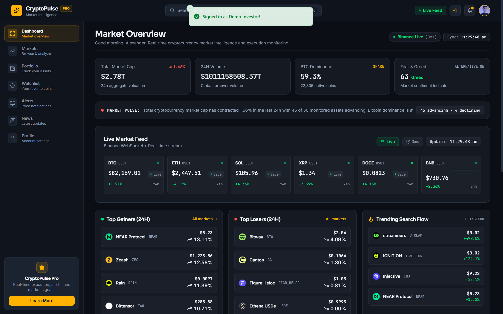
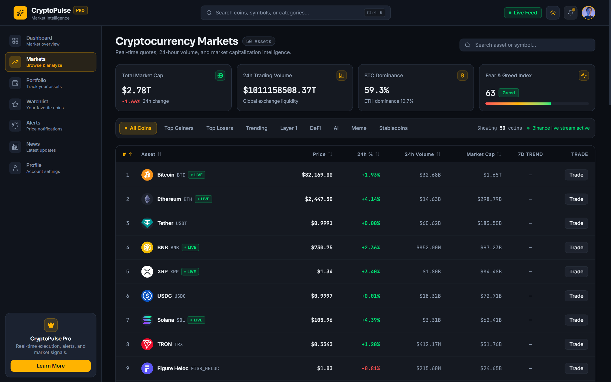
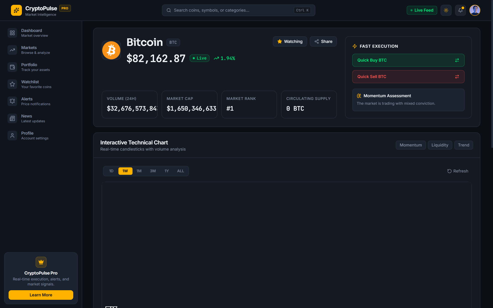
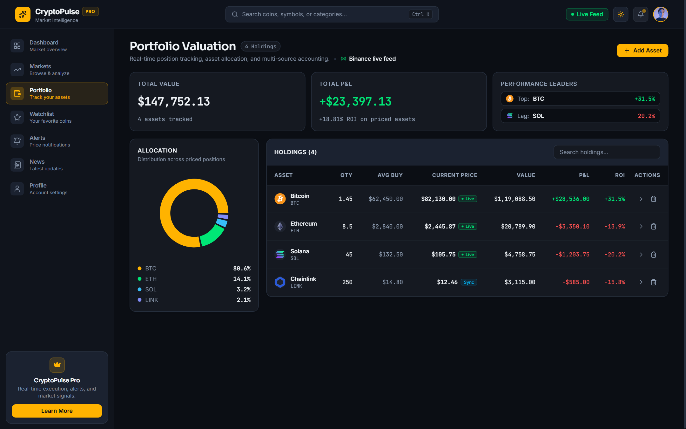
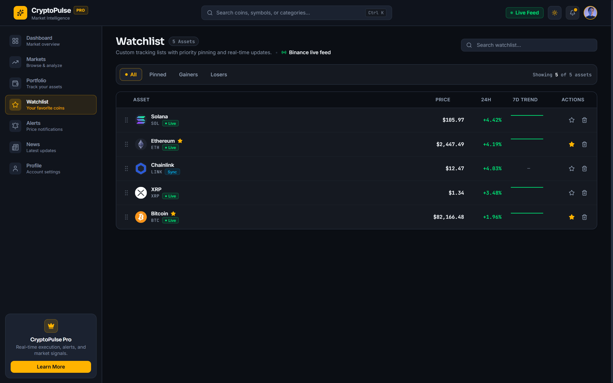
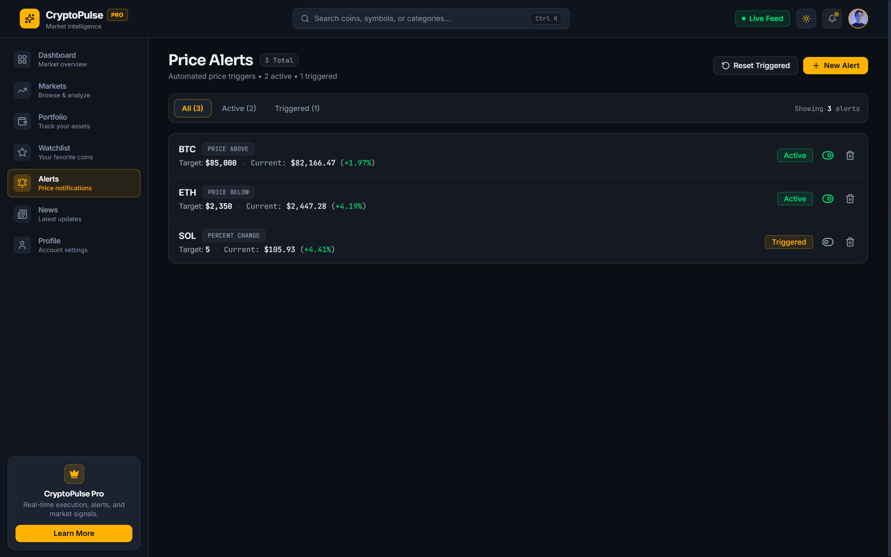
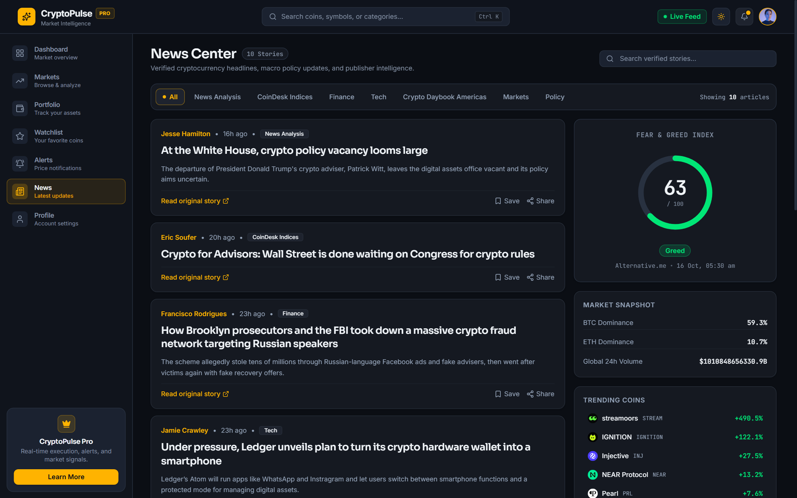
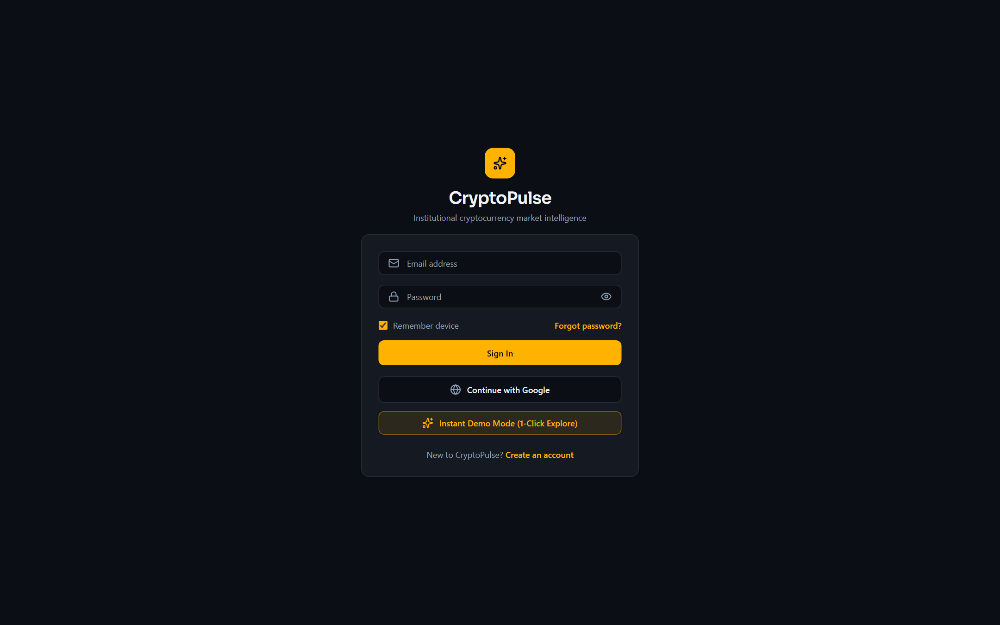

# ⚡ CryptoPulse — Institutional Cryptocurrency Market Intelligence & Trading Terminal

<p align="center">
  
  
  
  
  
  
  
  
  
</p>

<p align="center">
  <strong>CryptoPulse</strong> is a modern, high-performance cryptocurrency terminal engineered for active traders and institutional investors. Featuring sub-second live streaming price feeds via Binance WebSockets, CoinGecko market aggregation, TradingView-grade interactive OHLC candlestick charting, automated real-time price alerts, portfolio asset valuation, and news sentiment intelligence.
</p>

---

## 📸 Platform Showcase

### 1. Market Overview & Live Execution Dashboard
> Real-time aggregate market metrics ($2.78T Market Cap, 24h volume, 59.3% Bitcoin dominance), Alternative.me Fear & Greed index dial, sub-millisecond Binance WebSocket price streams with live status indicators, top gainers, losers, and trending search flows.

<p align="center">
  
</p>

---

### 2. Cryptocurrency Markets Terminal
> High-density market intelligence table tracking hundreds of coins with real-time price quotes, 24h percentage swings, volume rankings, live badges, and one-click execution triggers across Layer 1, DeFi, AI, Meme, and Stablecoins.

<p align="center">
  
</p>

---

### 3. Professional Technical Charting & Asset Intelligence
> TradingView-grade interactive technical charts with customizable timeframes (1D, 1W, 1M, 3M, 1Y, ALL), volume histogram, momentum indicators, order books, fast buy/sell execution actions, and live price feeds.

<p align="center">
  
</p>

---

### 4. Multi-Asset Portfolio Valuation & Allocation Analytics
> Real-time portfolio net worth computation, multi-source accounting, interactive asset allocation donut chart, performance leaderboards (top gainers and lagging assets), weighted average cost calculation, and unrealized/realized PnL metrics.

<p align="center">
  
</p>

---

### 5. Priority Pinned Watchlist
> Custom tracking watchlists with priority asset pinning, real-time Binance tick synchronizers, drag-and-drop reordering, 7-day sparkline trend visualizers, and instant asset navigation.

<p align="center">
  
</p>

---

### 6. Real-Time Price Alerts Engine
> Automated background alert engine triggering instant browser and in-app notifications on price breaches (`PRICE_ABOVE`, `PRICE_BELOW`), daily percentage swings, and volume spikes.

<p align="center">
  
</p>

---

### 7. Verified News Center & Market Sentiment
> Live institutional crypto news curated by industry, topic filters, market impact tags, and integrated sentiment snapshot gauges.

<p align="center">
  
</p>

---

### 8. Institutional Security & 1-Click Demo Mode
> Enterprise security powered by Supabase PostgreSQL Row Level Security (RLS), email/password authentication, Google OAuth 2.0, session persistence, device auditing, and a built-in 1-Click Instant Demo Mode for immediate evaluation.

<p align="center">
  
</p>

---

## ⚡ Key Features

- **⚡ Sub-Millisecond WebSocket Engine**: Direct Binance stream integration delivering zero-latency tick updates for BTC, ETH, SOL, BNB, XRP, and DOGE with automated reconnection and fallback to REST APIs.
- **📊 TradingView-Grade OHLC Charts**: Canvas-accelerated candlestick charts via `@tradingview/lightweight-charts`, supporting multiple timeframes, volume overlays, and technical momentum indicators.
- **💼 Real-Time Portfolio Analytics**: Track holdings, position weights, total valuation, average buy price, and net ROI with dynamic allocation donut visualizations.
- **⭐ Priority Watchlist**: Pin core assets to the top, filter by 24h gainers/losers, and reorder assets with fluid animations.
- **🔔 Live Alert Trigger Engine**: Background monitoring service that continuously cross-references market ticks against user-defined alert thresholds.
- **📰 Curated News & Macro Intelligence**: Real-time articles categorized by DeFi, Policy, Analysis, and Tech with Fear & Greed index tracking.
- **🔐 Enterprise Security & Supabase Backend**: PostgreSQL database with Row Level Security (RLS) guaranteeing strict cross-user data isolation, PKCE OAuth flows, and session management.
- **🚀 1-Click Instant Demo Mode**: Test and explore the complete application immediately without needing to configure backend credentials or register.
- **🎨 Ultra-Premium Dark/Light UI**: Built on Tailwind CSS v4, Sora & JetBrains Mono typography, custom glassmorphism design tokens, and smooth Framer Motion page transitions.

---

## 🛠️ Technology Stack

| Layer | Technologies |
|---|---|
| **Core Framework** | [React 19](https://react.dev/) + [TypeScript](https://www.typescriptlang.org/) + [Vite 8](https://vitejs.dev/) |
| **Styling & Design** | [TailwindCSS v4](https://tailwindcss.com/) + CSS Design Tokens + Custom Glassmorphism |
| **State Management** | [Zustand 5](https://github.com/pmndrs/zustand) with localStorage persistence & scoped hydration |
| **Server State & Caching** | [TanStack React Query v5](https://tanstack.com/query) with intelligent stale-time caching |
| **Real-Time Data** | Native WebSockets (Binance Stream) + CoinGecko REST v3 + Alternative.me API |
| **Charts & Visualizations** | [Lightweight Charts v5](https://tradingview.github.io/lightweight-charts/) + [Recharts v3](https://recharts.org/) |
| **Motion & Interaction** | [Framer Motion 12](https://www.framer.com/motion/) + [Lucide React](https://lucide.dev/) Icons |
| **Backend & Database** | [Supabase](https://supabase.com/) (PostgreSQL 15, Auth, Row Level Security, Storage) |
| **Notifications** | [Sonner](https://sonner.emilkowal.ski/) toast system + Web Notification API |
| **Validation & Forms** | [Zod v4](https://zod.dev/) + [React Hook Form](https://react-hook-form.com/) |
| **Quality & Testing** | Built-in Node test runner (`node --test`), ESLint, Oxlint, Prettier |

---

## 🏗️ Architecture & Data Flow

```mermaid
flowchart TD
    subgraph DataSources["External Data Feeds"]
        WS["Binance WebSockets (Sub-second Live Tickers)"]
        CG["CoinGecko REST API (Market Cap, Sparklines, Volumes)"]
        FG["Alternative.me (Fear & Greed Sentiment)"]
        NEWS["Crypto News Intelligence API"]
    end

    subgraph State["Client State (Zustand & React Query)"]
        LP["useLivePriceStore"]
        PS["usePortfolioStore"]
        WS_STORE["useWatchlistStore"]
        AS["useAlertStore"]
        AUTH["useAuthStore"]
        CACHE["User Cache (localStorage partition)"]
    end

    subgraph Backend["Cloud Infrastructure (Supabase)"]
        PG[("PostgreSQL Database (RLS Enforced)")]
        AUTH_SVC["Supabase Auth & OAuth"]
        STORAGE["Supabase Storage (User Avatars)"]
    end

    subgraph UI["CryptoPulse Terminal UI"]
        DASH["Dashboard & Live Tickers"]
        MARKETS["Markets Terminal"]
        CHART["Interactive OHLC Candlestick Chart"]
        PORT["Portfolio Valuation & Allocation"]
        WATCH["Priority Watchlist"]
        ALERTS["Alerts Engine"]
        FEED["News Center"]
    end

    WS --> LP
    CG --> State
    FG --> State
    NEWS --> FEED

    LP --> DASH
    LP --> MARKETS
    LP --> CHART
    LP --> PORT
    LP --> ALERTS

    AUTH --> AUTH_SVC
    PS <--> PG
    WS_STORE <--> PG
    AS <--> PG
    AUTH <--> STORAGE

    State <--> CACHE
    State --> UI
```



---

## 🚀 Getting Started

### Prerequisites

- **Node.js**: `v20.0.0` or higher (tested with Node `v24`)
- **Package Manager**: `npm`, `pnpm`, or `yarn`

### Quick Start (Local Setup)

1. **Clone the repository**:
   ```bash
   git clone https://github.com/rishik1072/CryptoPulse.git
   cd CryptoPulse
   ```

2. **Install dependencies**:
   ```bash
   npm install
   ```

3. **Configure environment variables**:
   Copy `.env.example` to `.env`:
   ```bash
   cp .env.example .env
   ```

4. **Launch the development server**:
   ```bash
   npm run dev
   ```

   The application will be running at **`http://localhost:3000`**.

5. **Instant Demo Mode**:
   On the Sign-In screen, click **"Instant Demo Mode (1-Click Explore)"** to instantly enter the terminal with pre-populated holdings, live WebSocket price feeds, and custom watchlists—no configuration required!

---

## 🔑 Environment Variables Reference

Create a `.env` file in the project root:

```env
# Supabase Configuration
VITE_SUPABASE_URL=https://your-project.supabase.co
VITE_SUPABASE_ANON_KEY=your-supabase-anon-key

# Optional News API (Fallback provided automatically)
VITE_CRYPTO_COMPARE_API_KEY=your-optional-key
```

> **Note:** For full database persistence instructions and SQL migrations, see [`SUPABASE_SETUP_GUIDE.md`](./SUPABASE_SETUP_GUIDE.md).

---

## 📁 Project Structure

```
CryptoPulse/
├── public/                 # Static public assets
├── screenshots/            # High-resolution platform documentation screenshots
│   ├── alerts.png          # Automated price alerts terminal
│   ├── dashboard.png       # Live market dashboard & feeds
│   ├── markets.png         # Comprehensive markets explorer
│   ├── news.png            # News center with sentiment dials
│   ├── portfolio.png       # Portfolio allocation & holdings
│   ├── signin.png          # Authentication portal & demo entry
│   ├── trading_chart.png   # Interactive OHLC candlestick chart
│   └── watchlist.png       # Priority pinned watchlist
├── src/
│   ├── components/
│   │   ├── alerts/         # Alert creation and management modals
│   │   ├── charts/         # TradingView OHLC chart, Recharts sparklines
│   │   ├── dashboard/      # Live tickers, Fear & Greed gauge, Movers
│   │   ├── layout/         # AppLayout, Navbar, Sidebar, ProfileMenu
│   │   ├── portfolio/      # AddAssetModal, TradeSimulatorModal
│   │   └── ui/             # CommandPalette, Skeletons, PriceChange, Modals
│   ├── constants/          # Coin listings, categories, configuration
│   ├── context/            # React AuthContext
│   ├── hooks/              # Custom hooks (useAuth, useMarket, useLivePrice)
│   ├── lib/                # Supabase client, theme manager, utils
│   ├── pages/              # Application views
│   │   ├── Alerts.tsx      # Price alerts configuration
│   │   ├── AssetDetail.tsx # OHLC chart, coin metrics & order actions
│   │   ├── Dashboard.tsx   # Primary command center & metrics
│   │   ├── Markets.tsx     # Full cryptocurrency asset table
│   │   ├── News.tsx        # News feed with sentiment analysis
│   │   ├── Portfolio.tsx   # Position valuation & allocation
│   │   ├── Profile.tsx     # Account details and sessions
│   │   ├── Settings.tsx    # Security, preferences, 2FA, data export
│   │   ├── SignIn.tsx      # Login with OAuth & Demo mode
│   │   ├── SignUp.tsx      # User registration
│   │   └── Watchlist.tsx   # Pinned coin watchlist
│   ├── providers/          # QueryProvider, AuthProvider
│   ├── services/           # Binance WS, CoinGecko API, News API, RLS service
│   ├── store/              # Zustand stores (Auth, Portfolio, Watchlist, Alert, UI)
│   ├── styles/             # Design tokens & color system
│   └── App.tsx             # Root router, routes & lazy suspense boundaries
├── supabase/               # SQL schema migrations & Row Level Security policies
├── SUPABASE_SETUP_GUIDE.md # Comprehensive guide for Supabase deployment
└── package.json            # Project manifest & dependency declarations
```

---

## 🧪 Testing & Verification

CryptoPulse features an extensive test suite verifying database isolation, XSS protection, timeframes, chart deduplication, and auth security:

```bash
# Run test suite
npm test

# Run ESLint validation
npm run lint

# Check production TypeScript build
npm run build
```

```
ℹ tests 105
ℹ suites 24
ℹ pass 105
ℹ fail 0
ℹ duration_ms 969.864
```

---

## 🛡️ Security & Invariants

- **Row Level Security (RLS)**: Enforced on all Supabase tables (`portfolios`, `holdings`, `watchlist_items`, `alerts`, `profiles`). Users can only query and mutate their own records.
- **XSS Sanitization**: User-controlled inputs, notes, and avatar URLs are strictly sanitized. External links enforce `rel="noreferrer noopener"`.
- **Secret Isolation**: `SUPABASE_SERVICE_ROLE_KEY` is strictly prohibited in frontend bundles; only client-safe anonymous keys are used.
- **Cross-User Scope Hydration**: Zustand persistence isolates cache keys per authenticated user ID (`cryptopulse-portfolio-${userId}`) to eliminate cross-session data leakage.

---

## 📜 Available Scripts

| Command | Action |
|---|---|
| `npm run dev` | Starts the Vite development server on `http://localhost:3000` |
| `npm run build` | Compiles TypeScript and creates optimized production bundle in `dist/` |
| `npm test` | Runs the test suite using Node's native test runner |
| `npm run lint` | Runs ESLint with zero-warning threshold |
| `npm run format` | Formats all code with Prettier and Tailwind CSS plugin |
| `npm run preview` | Locally previews the production build bundle |

---

## 🤝 Contributing

Contributions, issues, and feature requests are welcome! Feel free to check the [issues page](https://github.com/rishik1072/CryptoPulse/issues).

1. Fork the Project
2. Create your Feature Branch (`git checkout -b feature/AmazingFeature`)
3. Commit your Changes (`git commit -m 'Add some AmazingFeature'`)
4. Push to the Branch (`git push origin feature/AmazingFeature`)
5. Open a Pull Request

---

## 📄 License

Distributed under the MIT License. See `LICENSE` for more information.

---

<p align="center">
  Crafted with precision for modern crypto markets • <strong>CryptoPulse</strong>
</p>
